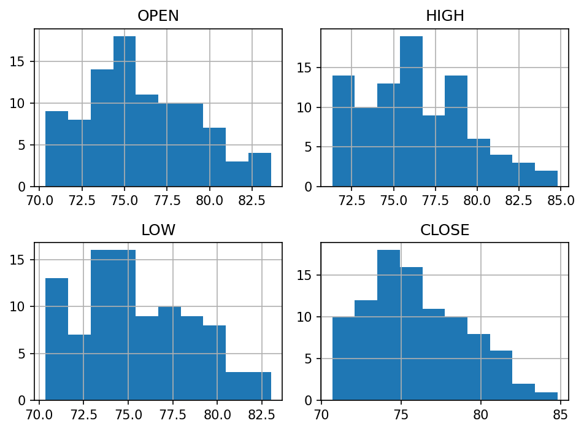
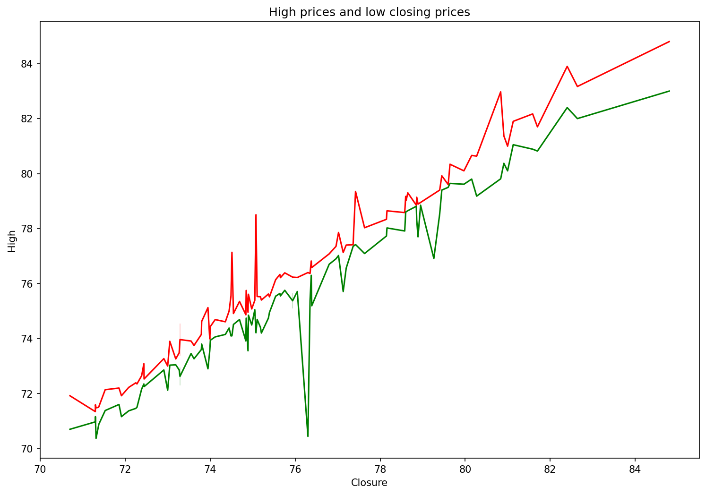
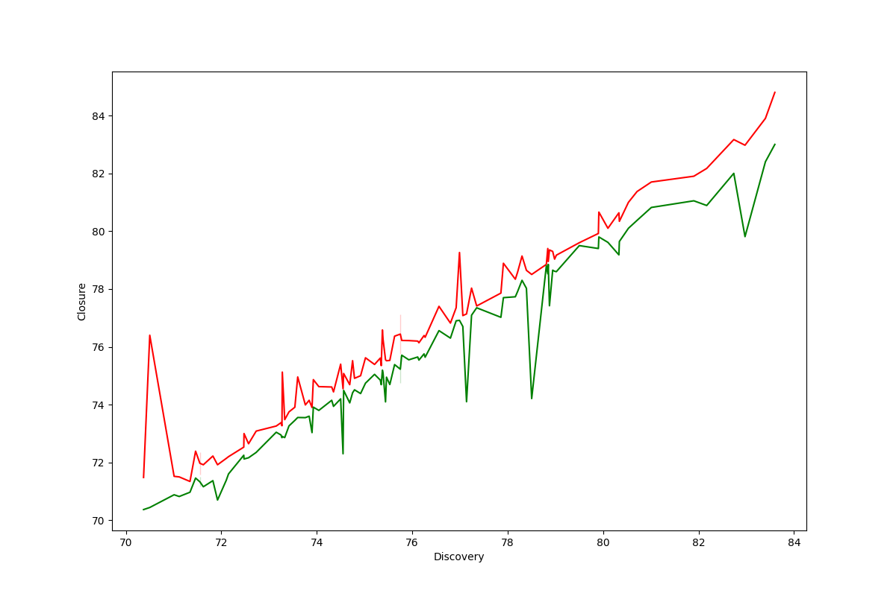
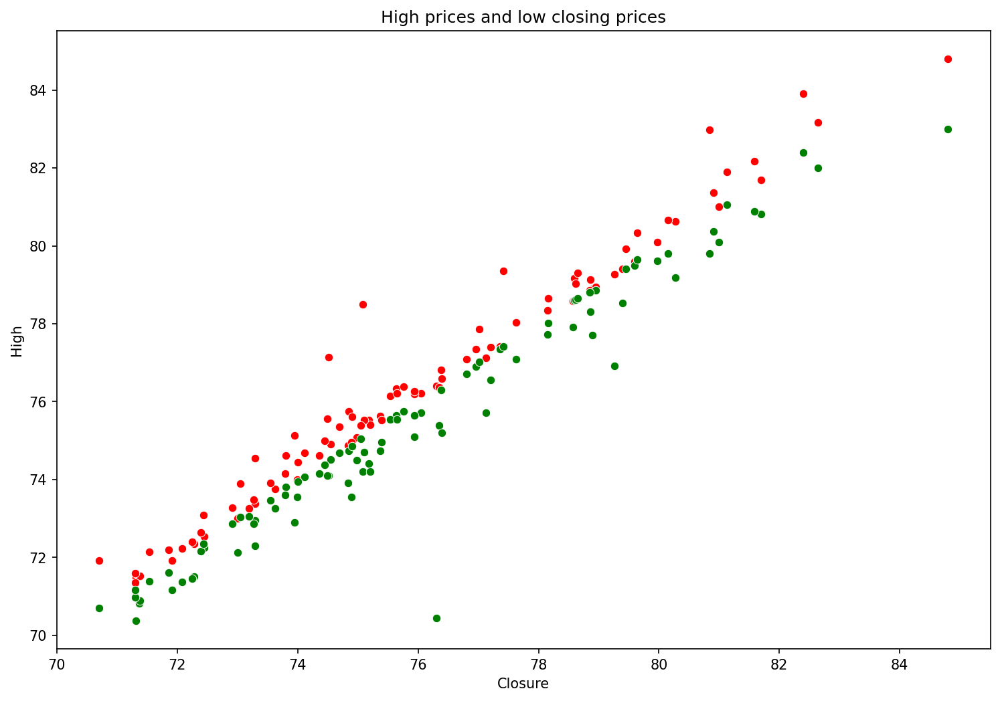

# MOEX USD/RUB Data Pipeline & Price Prediction

## 📌 Overview
This repository contains an end-to-end data pipeline that automates the ingestion, preprocessing, and exploratory analysis of financial currency data (USD000UTSTOM) from the Moscow Exchange (MOEX) API. The project cleans the raw market logs and leverages a Linear Regression model to analyze and predict closing currency prices based on daily trading attributes.

## 🛠️ Tech Stack
- **Language:** Python 3.10+
- **Data Engineering:** Pandas, Requests, Logging Architecture
- **Machine Learning & Analytics:** Scikit-Learn (Linear Regression), NumPy
- **Storage:** Local CSV Ingestion Management
- - **Machine Learning, Analytics & Visualizations:** Scikit-Learn (Linear Regression), NumPy, Matplotlib / Seaborn

## 🏗️ Pipeline Architecture
The script operates as a functional modular pipeline executing the following phases:
1. **Data Ingestion (`parsing`):** Programmatically queries the MOEX ISS REST API in batches, handling currency history pagination and filtering out invalid trading sessions.
2. **Data Cleaning (`clean_df`):** Automatically drops duplicate entries, filters out zero-value market volatility anomalies, and preserves production-grade history checkpoints.
3. **Exploratory Data Analysis (`exploratory_da`):** Provides instant terminal-based diagnostic validation metrics (missing values, statistical distribution profiling, data type drift check).
4. **Predictive Modeling (`mashingan`):** Segregates features, performs custom train-test validation splits, trains a Scikit-Learn `LinearRegression` model, and scores predictive performance using MSE and R² metrics.

## ⚙️ Project Structure & Data Chest
The repository maintains a production-style file schema:
- `Data chest/` — Automatically generated directory holding raw and post-processed operational data.
- `Loggers/` — Persistent application flow auditing (stores execution context outputs inside `log_report.txt`).

## 🚀 How to Run

1. **Clone the repository:**
   ```bash
   git clone https://github.com
   cd moex-data-pipeline
   ```

2. **Install dependencies:**
   ```bash
   pip install pandas requests scikit-learn
   ```

3. **Execute the core pipeline:**
   ```bash
   python main.py
   ```
## 📊 Visualizations & Analytics
Below are the data distribution and market analysis plots generated automatically by the pipeline:

### 1. Target Variable Distribution


### 2. Closure Price Analysis


### 3. Market Open vs High/Low Analytics


### 4. High Price Analysis



